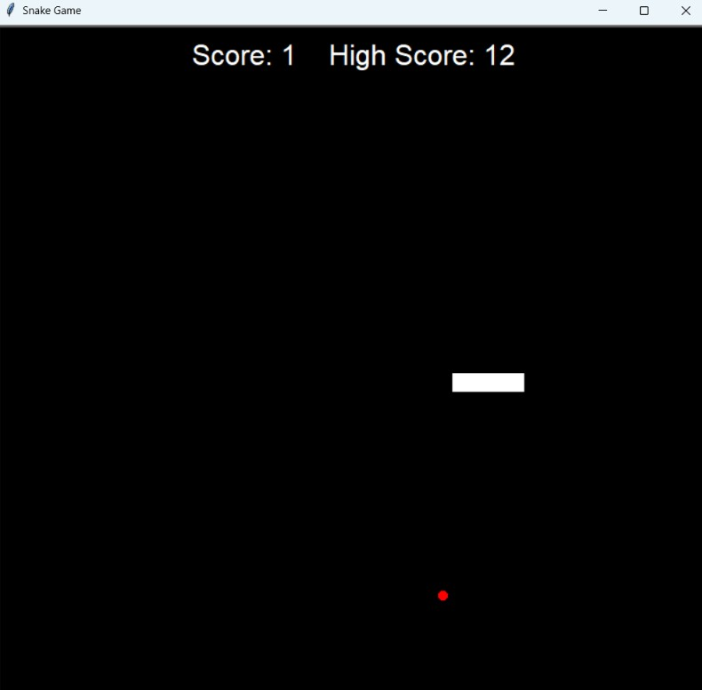

# 🐍 Snake Game

Un jeu Snake classique développé en Python avec le module `turtle`.



## Fonctionnalités

- Déplacement du serpent avec les flèches du clavier
- Le serpent grandit à chaque nourriture mangée
- Score en temps réel et meilleur score sauvegardé automatiquement
- Fin de partie en cas de collision avec un mur ou avec le corps du serpent

## Commandes

| Touche | Action |
|--------|--------|
| ⬆️ Haut | Aller vers le haut |
| ⬇️ Bas | Aller vers le bas |
| ⬅️ Gauche | Aller vers la gauche |
| ➡️ Droite | Aller vers la droite |

## Lancer le jeu

### Option 1 : Exécutable Windows

Télécharge `snake-game.exe` depuis la page des [Releases](https://github.com/omarzawem-design/snake-game/releases) et double-clique dessus.

### Option 2 : Depuis le code source

Prérequis : Python 3 (le module `turtle` est inclus, aucune installation supplémentaire n'est nécessaire).

```bash
git clone https://github.com/omarzawem-design/snake-game.git
cd snake-game
python main.py
```

## Structure du projet

```
snake-game/
├── main.py         # Boucle principale du jeu
├── snake.py        # Classe Snake (déplacement, croissance)
├── food.py         # Classe Food (apparition aléatoire)
├── scoreboard.py   # Score et meilleur score
└── README.md
```

## Auteur

**Omar Zawem**
- GitHub: [@omarzawem-design](https://github.com/omarzawem-design)
- LinkedIn: [Omar Zawem](https://linkedin.com/in/omar-zawem-40746b339)